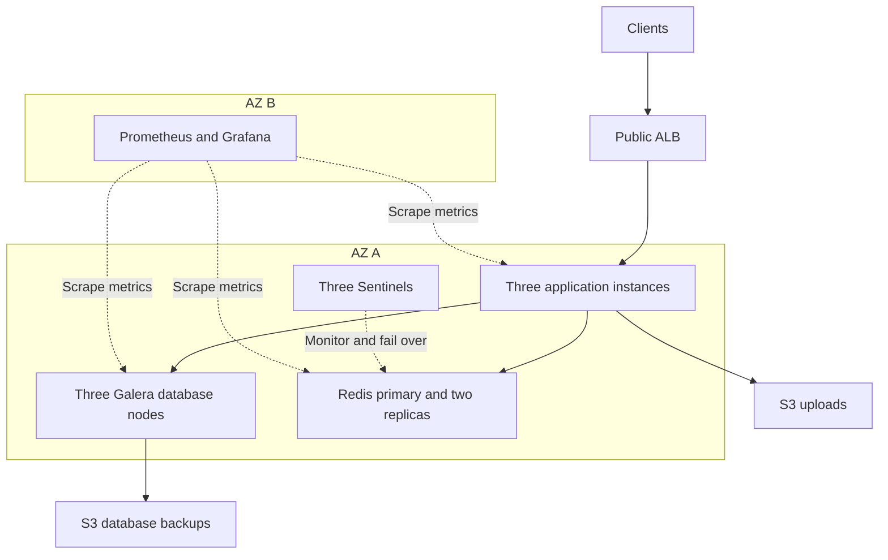

# RollingDeployment

AWS infrastructure and deployment automation for [TheSchool](https://github.com/StasX/TheSchool), with separate MariaDB Galera and Redis/Sentinel tiers and a [Monitoring](https://github.com/StasX/Monitoring) stack.

The project combines Terraform, Python (Boto3), Ansible, and Docker Compose to provision infrastructure, configure hosts, and deploy application releases incrementally.

## Architecture

One VPC spans two Availability Zones. Application, database, and Redis instances reside in AZ A; monitoring resides in AZ B. The public Application Load Balancer uses subnets in both AZs.

| Location | Component | Count | Purpose |
| --- | --- | ---: | --- |
| AZ A | Application EC2 | 3 | Run TheSchool behind the ALB |
| AZ A | Database EC2 | 3 | Run a MariaDB Galera cluster |
| AZ A | Redis EC2 | 3 | One Redis instance and one Sentinel container per host |
| AZ B | Monitoring EC2 | 1 | Run Prometheus and Grafana |
| **Total EC2** | | **10** | Nine hosts in AZ A, one in AZ B |
| AZ A + AZ B | Application Load Balancer | 1 | Route HTTP requests to application instances |



### Availability tradeoff

The three-node Galera cluster is designed to retain quorum after one database-node failure, provided the other two nodes remain connected. Application releases run one instance at a time; preserving service requires enough healthy capacity on the remaining instances.

All application, database, and Redis nodes share AZ A. An AZ A outage therefore stops the application, database, and Redis service. Monitoring in AZ B can remain running and detect the loss of its targets. This architecture prioritizes local database communication and instance-level resilience; it does not provide application availability through an AZ A outage.

An asynchronous MariaDB replica in AZ B is a possible future disaster-recovery extension. It is not part of the initial ten-instance layout.

### Networking and storage

- EC2 instances currently use public subnets and public IPs for controlled SSH access and outbound downloads.

- Application HTTP traffic is allowed from the ALB security group only.

- MariaDB connections use private IPs and port `3306`, allowed from the application security group.

- Galera traffic on `4567/TCP`, `4567/UDP`, `4568/TCP`, and `4444/TCP` is restricted to members of the database security group.

- Redis port `6379` permits application access and communication between Redis hosts. Sentinel port `26379` permits application discovery and communication between Redis hosts. Both use private addresses.
- Node Exporter port `9100` on application, database, and Redis hosts is allowed from the monitoring security group.

- SSH and Grafana access are restricted by `ADMIN_ALLOWED_CIDR`.

- Each database node has a separate encrypted 100 GiB `gp3` data volume. Formatting, mounting, and database storage configuration belong to host provisioning.

- Redis uses a persistent host directory on each EC2 root volume; dedicated Redis data volumes are not currently defined.
- EC2 root volumes are encrypted, and instance metadata requires IMDSv2.

- The current ALB listener serves HTTP. Opening port `443` in its security group does not configure HTTPS; a certificate and HTTPS listener are still required.

## Technology stack

| Area | Technology | Responsibility |
| --- | --- | --- |
| Infrastructure | Terraform, AWS | VPC, subnets, EC2, ALB, EBS, IAM, S3, optional Route 53 |
| Orchestration | Python, Boto3 | Prepare state storage, run Terraform, discover hosts, and invoke Docker setup |
| Host configuration | Ansible | Docker installation and application, database, Redis/Sentinel, and monitoring roles |
| Runtime | Docker Engine, Docker Compose | Run application, database, Redis, Sentinel, and monitoring containers |
| Database | MariaDB Galera | Three-node database tier with a custom container image |
| Shared state | Redis, Sentinel | Shared sessions, cache, and queues with primary/replica failover |
| Observability | Prometheus, Grafana, Node Exporter | Host metrics and dashboards |
| Local setup | Bash, PowerShell, WSL | Prepare tooling and invoke the bootstrap |

## Repository layout

| Path | Purpose |
| --- | --- |
| `infra/` | Terraform resource definitions and outputs |
| `config/` | S3 bucket security helper |
| `utils/backend.py` | Prepare and secure the state bucket |
| `utils/terraform.py` | Run Terraform and parse/validate host outputs |
| `utils/ansible.py` | Invoke Docker setup using all host public IPs |
| `ansible/ansible.cfg` | Ansible connection and role configuration |
| `ansible/playbooks/` | Setup, database, Redis, application, and monitoring playbooks |
| `ansible/roles/docker/` | Docker Engine and Compose installation |
| `ansible/roles/app/` | TheSchool checkout, environment, Compose deployment, and health checks |
| `ansible/roles/database/` | EBS preparation, Galera configuration, and Compose deployment tasks |
| `ansible/roles/redis/` | Redis/Sentinel initial configuration, persistence, and Compose deployment |
| `ansible/roles/monitoring/` | Monitoring repository checkout and Compose deployment |
| `scripts/` | Tool installation and SSH key generation |
| `keys/` | Locally generated SSH keys; private keys must stay out of Git |
| `main.py` | Orchestrate backend, Terraform, host discovery, and Docker setup |
| `deploy.sh`, `deploy.ps1` | Local setup entrypoints |
| `example.env` | Environment configuration template |

## Configuration

Copy the template and edit it before running the bootstrap:

```bash
cp example.env .env
```

PowerShell:

```powershell
Copy-Item example.env .env
```

| Variable | Example | Purpose |
| --- | --- | --- |
| `PROJECT_NAME` | `theschool-your-unique-suffix` | Resource identifier and current Terraform state bucket name; choose a globally unique, lowercase S3-compatible value |
| `REGION` | `us-east-1` | Region used by Boto3 and the Terraform backend |
| `AWS_DEFAULT_REGION` | `us-east-1` | AWS provider region; keep aligned with `REGION` |
| `MOST_RECENT` | `true` | Select the newest matching Ubuntu AMI |
| `AMI_ID` | empty | Optional explicit AMI ID |
| `USE_DOMAIN` | `false` | Enable the Route 53 application record |
| `DOMAIN_NAME` | empty | Existing public hosted-zone domain, required when `USE_DOMAIN=true` |
| `ADMIN_ALLOWED_CIDR` | `203.0.113.10/32` | Replace this documentation address with your actual administrator public IPv4 CIDR |

The entrypoint loads `.env` into the process environment. Python explicitly passes `AWS_ACCESS_KEY_ID` and `AWS_SECRET_ACCESS_KEY` to Boto3; Terraform inherits the AWS environment. Temporary credentials also require the session token to be handled correctly. The current AWS provider configuration does not consume the custom `REGION` variable directly, so set `AWS_DEFAULT_REGION` or configure the same region in your AWS profile.

Terraform rejects `ADMIN_ALLOWED_CIDR=0.0.0.0/0`; `0.0.0.0` without a prefix is also invalid. Use an appropriate restrictive CIDR.

Ansible will additionally need application secrets and runtime settings, including the application key, database credentials, Redis connection details, application URL, and uploads bucket name. Terraform outputs alone do not supply all of these values.

## Local setup and execution

Requirements:

- An AWS account and credentials permitted to manage the defined resources.

- A region with at least two available AZs.

- Git and Bash on Linux, or PowerShell with a configured WSL Linux distribution on Windows.

- Access to AWS APIs, package repositories, and application repositories.

Run from the repository root:

```bash
bash ./deploy.sh
```

PowerShell entrypoint:

```powershell
.\deploy.ps1
```

The setup scripts load `.env`, export Terraform inputs, generate SSH keys, prepare local tools, and install Python dependencies in a virtual environment. Ansible runs on Linux. On Windows, run the orchestration within WSL, or implement an explicit WSL invocation bridge; installing Ansible in WSL does not make it executable by Windows Python.

**The deployment entrypoint invokes `main.py --apply`, which applies infrastructure and then runs Docker setup. Run it in the same Linux/WSL environment as Terraform, Python, Ansible, and the SSH keys.

For direct Python execution, after preparing the virtual environment and loading environment variables:

```bash
./env/bin/python main.py          # Create a Terraform plan
./env/bin/python main.py --apply  # Apply a new plan, discover hosts, and run Docker setup
```

Without `--apply`, infrastructure resources are only planned, but the Python bootstrap can still create or update the S3 state bucket. With `--apply`, Python creates a new plan, applies it, reads host outputs, and invokes `setup.yml`; it does not reuse a plan reviewed during a previous invocation.

## Terraform state and host discovery

Python prepares an S3 bucket named by `PROJECT_NAME`, enables or checks public-access blocking and versioning, and initializes Terraform with:

- State key: `env/terraform.tfstate`

- Native S3 locking: `use_lockfile=true`

- Saved local plan: `infra/tfplan`

Host information is exposed through these Terraform outputs:

| Output | Use |
| --- | --- |
| `app_public_ips` | SSH access to application hosts |
| `app_private_ips` | Internal application addresses and monitoring targets |
| `database_public_ips` | SSH access to database hosts |
| `database_private_ips` | Galera membership, database connections, and monitoring targets |
| `redis_public_ips` | SSH access to Redis hosts |
| `redis_private_ips` | Redis replication, Sentinel discovery, and monitoring targets |
| `monitoring_public_ip` | SSH access and administrator Grafana access |
| `monitoring_private_ip` | Internal monitoring address |
| `app_url` | ALB or custom-domain application URL |

Python reads `terraform output -json` after a successful apply. Outputs include existing managed hosts even when no infrastructure changes occur. They are state values; `setup.yml` waits for Ansible connection readiness before gathering facts. SSH host trust must also be configured because host-key checking is enabled.

## Ansible workflow

The current Python flow runs Terraform and then `setup.yml`. It passes all ten public IPs as inline inventory, the SSH key path, and `project_name` through CLI arguments. `utils/ansible.py` selects `ansible/ansible.cfg` and uses the Ansible directory as its working directory.

`setup.yml` waits for SSH/Python readiness, gathers facts, and installs Docker Engine and Compose on all hosts. It does not yet invoke the service-specific playbooks.

Service deployment order:

1. Provision storage and explicitly bootstrap the first Galera node, then join the other database nodes.
2. Initialize the designated Redis primary first, followed by replicas and Sentinels.
3. Configure monitoring with private targets.
4. Deploy application hosts using external database and Redis connections.

The service playbooks use `hosts: all`; Python must supply only the relevant hosts for each invocation. Database and Redis configuration also require per-host variables, such as private addresses, node names, and container UID/GID. A generated inventory can carry those values without a committed static inventory directory. Inline inventory lists require a trailing comma.

## Database provisioning

The database role validates configuration and secrets, inspects the supplied EBS device, and formats a blank volume only when `database_allow_format` is enabled. It mounts by filesystem UUID and renders Galera, environment, and Compose templates.

The custom image must implement initialization, SST credentials, Galera startup, and a health check for Primary, ready, and Synced status. First-cluster bootstrap and full-cluster recovery are explicit operations; a persistent bootstrap flag must not create a new cluster on ordinary restarts. Database maintenance processes one host at a time.

## Redis and Sentinel

Three dedicated Redis EC2s in AZ A each run Redis and Sentinel containers. The initial topology is one primary and two replicas, with three Sentinels and quorum set to two. This is a replicated Redis deployment, not a sharded Redis Cluster.

Host networking and private address announcements make discovered endpoints reachable inside the VPC. Redis data and writable configuration live in persistent host directories. Initial configuration templates use `force: false` so subsequent runs preserve rewritten replication and Sentinel state. Password rotation and topology changes need deliberate maintenance rather than reapplying the initial configuration.

Redis uses AOF persistence with `appendfsync everysec` and a `noeviction` policy. Persistence and asynchronous replication do not guarantee zero data loss during failures. Local PING health checks establish responsiveness; final validation must check replica links, Sentinel agreement, and failover behavior.

Laravel needs a Sentinel-aware connection implementation and all Sentinel endpoints plus the monitored primary name. A fixed `REDIS_HOST` alone will not follow a promoted primary.

## Application releases

The application role checks out TheSchool, renders its environment file, starts Docker Compose services, and checks `/api/health`. The deployment playbook processes one application host at a time and stops subsequent batches on failure.

Reliable rolling releases require immutable release selection, ALB deregistration and connection draining, target-health verification before proceeding, and tested rollback to the previous release. Local health checks alone do not establish zero-downtime deployment.

Database schema changes need a separate migration strategy compatible with both old and new application versions. Sessions, cache, and queues use the shared Redis tier once Sentinel discovery is integrated. The production Compose file must exclude local MariaDB and standalone local Redis services.

## IAM and backups

| Host role | Permissions |
| --- | --- |
| Application | SSM and access to the uploads bucket |
| Database | SSM and backup uploads to the database backups bucket |
| Redis | SSM |
| Monitoring | SSM |

Creating the backups bucket and granting `s3:PutObject` does not create a backup process. Scheduling backups, recording their success, and testing restoration remain necessary. Downloading backups for restoration requires additional read permissions.

## Infrastructure changes and cleanup

Many resources use `prevent_destroy`, and the ALB enables deletion protection. Moving existing instances between subnets, removing hosts, or changing database volume keys can require destructive actions that these protections block. Review the Terraform plan and prepare any data migration before changing those protections.

Provisioned resources incur ongoing charges. Keep `.env`, private keys, Terraform state, and saved plans out of Git, and protect application secrets supplied to Ansible. Public IPs provide reachability; security groups define the permitted inbound access.

## License

[Apache License 2.0](LICENSE).
