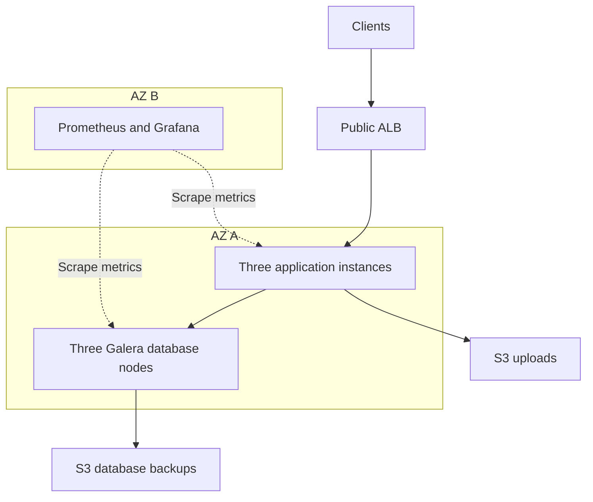

# RollingDeployment

AWS infrastructure and deployment automation for [TheSchool](https://github.com/StasX/TheSchool), with a separate MariaDB Galera database tier and a [Monitoring](https://github.com/StasX/Monitoring) stack.

The project combines Terraform, Python (Boto3), Ansible, and Docker Compose to provision infrastructure, configure hosts, and deploy application releases incrementally.

> **Status:** Work in progress. The revised infrastructure design uses seven EC2 instances. Ansible roles exist for Docker, application deployment, and monitoring. Python orchestration of Ansible, Galera configuration, and end-to-end deployment verification are the next steps. Automated rollback is planned.

## Architecture

One VPC spans two Availability Zones. Application and database instances reside in AZ A; monitoring resides in AZ B. The public Application Load Balancer uses subnets in both AZs.

| Location | Component | Count | Purpose |
| --- | --- | ---: | --- |
| AZ A | Application EC2 | 3 | Run TheSchool behind the ALB |
| AZ A | Database EC2 | 3 | Run a MariaDB Galera cluster |
| AZ B | Monitoring EC2 | 1 | Run Prometheus and Grafana |
| AZ A + AZ B | Application Load Balancer | 1 | Route HTTP requests to application instances |



### Availability tradeoff

The three-node Galera cluster is designed to retain quorum after one database-node failure, provided the other two nodes remain connected. Application releases run one instance at a time; preserving service requires enough healthy capacity on the remaining instances.

All application and database nodes share AZ A. An AZ A outage therefore stops the application and database. Monitoring in AZ B can remain running and detect the loss of its targets. This architecture prioritizes local database communication and instance-level resilience; it does not provide application availability through an AZ A outage.

An asynchronous MariaDB replica in AZ B is a possible future disaster-recovery extension. It is not part of the initial seven-instance layout.

### Networking and storage

- EC2 instances currently use public subnets and public IPs for controlled SSH access and outbound downloads.
- Application HTTP traffic is allowed from the ALB security group only.
- MariaDB connections use private IPs and port `3306`, allowed from the application security group.
- Galera traffic on `4567/TCP`, `4567/UDP`, `4568/TCP`, and `4444/TCP` is restricted to members of the database security group.
- Node Exporter port `9100` on application and database hosts is allowed from the monitoring security group.
- SSH and Grafana access are restricted by `ADMIN_ALLOWED_CIDR`.
- Each database node has a separate encrypted 100 GiB `gp3` data volume. Formatting, mounting, and database storage configuration belong to host provisioning.
- EC2 root volumes are encrypted, and instance metadata requires IMDSv2.
- The current ALB listener serves HTTP. Opening port `443` in its security group does not configure HTTPS; a certificate and HTTPS listener are still required.

## Technology stack

| Area | Technology | Responsibility |
| --- | --- | --- |
| Infrastructure | Terraform, AWS | VPC, subnets, EC2, ALB, EBS, IAM, S3, optional Route 53 |
| Orchestration | Python, Boto3 | Prepare Terraform state storage and run Terraform; Ansible integration planned |
| Host configuration | Ansible | Docker installation, application deployment, and monitoring deployment |
| Runtime | Docker Engine, Docker Compose | Run application and monitoring containers |
| Database | MariaDB Galera | Three-node database tier; provisioning planned |
| Observability | Prometheus, Grafana, Node Exporter | Host metrics and dashboards |
| Local setup | Bash, PowerShell, WSL | Prepare tooling and invoke the bootstrap |

## Repository layout

| Path | Purpose |
| --- | --- |
| `infra/` | Terraform resource definitions and outputs |
| `config/` | Python bootstrap helpers |
| `ansible/ansible.cfg` | Ansible connection and role configuration |
| `ansible/playbooks/` | Setup, application, and monitoring playbooks |
| `ansible/roles/docker/` | Docker Engine and Compose installation |
| `ansible/roles/app/` | TheSchool checkout, environment, Compose deployment, and health checks |
| `ansible/roles/monitoring/` | Monitoring repository checkout and Compose deployment |
| `scripts/` | Tool installation and SSH key generation |
| `keys/` | Locally generated SSH keys; private keys must stay out of Git |
| `main.py` | S3 state bootstrap and Terraform init, plan, and optional apply |
| `deploy.sh`, `deploy.ps1` | Local setup entrypoints |
| `example.env` | Environment configuration template |

## Configuration

Copy the template and edit it before running the bootstrap:

```bash
cp example.env .env
```

PowerShell:

```powershell
Copy-Item example.env .env
```

| Variable | Example | Purpose |
| --- | --- | --- |
| `PROJECT_NAME` | `theschool-your-unique-suffix` | Resource identifier and current Terraform state bucket name; choose a globally unique, lowercase S3-compatible value |
| `REGION` | `us-east-1` | Region used by Boto3 and the Terraform backend |
| `AWS_DEFAULT_REGION` | `us-east-1` | AWS provider region; keep aligned with `REGION` |
| `MOST_RECENT` | `true` | Select the newest matching Ubuntu AMI |
| `AMI_ID` | empty | Optional explicit AMI ID |
| `USE_DOMAIN` | `false` | Enable the Route 53 application record |
| `DOMAIN_NAME` | empty | Existing public hosted-zone domain, required when `USE_DOMAIN=true` |
| `ADMIN_ALLOWED_CIDR` | `203.0.113.10/32` | Replace this documentation address with your actual administrator public IPv4 CIDR |

AWS credentials must be available to Boto3 and Terraform through environment variables or the standard credential chain. The current AWS provider configuration does not consume the custom `REGION` variable directly, so set `AWS_DEFAULT_REGION` or configure the same region in your AWS profile.

Terraform rejects `ADMIN_ALLOWED_CIDR=0.0.0.0/0`; `0.0.0.0` without a prefix is also invalid. Use an appropriate restrictive CIDR.

Ansible will additionally need application secrets and runtime settings, including the application key, database credentials, Redis connection details, application URL, and uploads bucket name. Terraform outputs alone do not supply all of these values.

## Local setup and execution

Requirements:

- An AWS account and credentials permitted to manage the defined resources.
- A region with at least two available AZs.
- Git and Bash on Linux, or PowerShell with a configured WSL Linux distribution on Windows.
- Access to AWS APIs, package repositories, and application repositories.

Run from the repository root:

```bash
bash ./deploy.sh
```

PowerShell entrypoint:

```powershell
.\deploy.ps1
```

The setup scripts load `.env`, export Terraform inputs, generate SSH keys, prepare local tools, and install Python dependencies in a virtual environment. Ansible runs on Linux; the Windows installation script uses WSL.

**The Bash entrypoint currently invokes `main.py --apply`, which provisions infrastructure.** The PowerShell invocation must pass the script path and `--apply` as separate arguments:

```powershell
& "$venv\Scripts\python.exe" "$PSScriptRoot\main.py" --apply
```

For direct Python execution, after preparing the virtual environment and loading environment variables:

```bash
./env/bin/python main.py          # Create a Terraform plan
./env/bin/python main.py --apply  # Create and apply a new plan
```

Without `--apply`, infrastructure resources are only planned, but the Python bootstrap can still create or update the S3 state bucket. With `--apply`, Python creates a new plan and applies it; it does not reuse a plan reviewed during a previous invocation.

## Terraform state and host discovery

Python prepares an S3 bucket named by `PROJECT_NAME`, enables or checks public-access blocking and versioning, and initializes Terraform with:

- State key: `env/terraform.tfstate`
- Native S3 locking: `use_lockfile=true`
- Saved local plan: `infra/tfplan`

Host information is exposed through these Terraform outputs:

| Output | Use |
| --- | --- |
| `app_public_ips` | SSH access to application hosts |
| `app_private_ips` | Internal application addresses and monitoring targets |
| `database_public_ips` | SSH access to database hosts |
| `database_private_ips` | Galera membership, database connections, and monitoring targets |
| `monitoring_public_ip` | SSH access and administrator Grafana access |
| `monitoring_private_ip` | Internal monitoring address |
| `app_url` | ALB or custom-domain application URL |

The planned Python integration reads `terraform output -json` after a successful apply. Outputs include existing managed hosts even when no infrastructure changes occur. They are state values; Python must still wait for SSH readiness before invoking Ansible.

## Ansible workflow

Python will supply host lists, the SSH key path, and runtime variables through Ansible CLI arguments. A committed static inventory directory is unnecessary. A generated inventory can provide host groups and per-host variables as the workflow grows.

The intended sequence is:

1. Apply Terraform and read outputs.
2. Wait for all seven hosts to become reachable.
3. Run `setup.yml` against all seven hosts to install Docker and Compose.
4. Configure and bootstrap the Galera database tier using a database role/playbook to be added.
5. Run `monitoring.yml` against the monitoring host and configure private metric targets.
6. Run `deploy.yml` against the three application hosts.

The current playbooks use `hosts: all`, so Python must pass the appropriate host list to each invocation. Inline inventory lists require a trailing comma. Run from `ansible/`, or explicitly select `ansible/ansible.cfg`, so its role and SSH settings are loaded.

## Application releases

The application role checks out TheSchool, renders its environment file, starts Docker Compose services, and checks `/api/health`. The deployment playbook processes one application host at a time and stops subsequent batches on failure.

The remaining release work includes immutable release selection, ALB deregistration and connection draining, target-health verification before proceeding, and tested rollback to the previous release. Local health checks alone do not establish zero-downtime deployment.

Database schema changes need a separate migration strategy compatible with both old and new application versions. Redis-backed sessions and queues also need a deliberate shared topology across application hosts.

## IAM and backups

| Host role | Permissions |
| --- | --- |
| Application | SSM and access to the uploads bucket |
| Database | SSM and backup uploads to the database backups bucket |
| Monitoring | SSM |

Creating the backups bucket and granting `s3:PutObject` does not create a backup process. Scheduling backups, recording their success, and testing restoration remain necessary. Downloading backups for restoration requires additional read permissions.

## Implementation checklist

- [x] Python S3 backend bootstrap and Terraform plan/apply flow
- [x] Terraform definitions for the revised seven-instance architecture
- [x] Separate application, database, and monitoring IAM permissions
- [x] Ansible roles for Docker, application, and monitoring
- [x] Sequential application deployment and local health checks
- [ ] Verify the revised infrastructure end to end
- [ ] Fix remaining bootstrap/role integration issues and verify Windows execution through WSL
- [ ] Connect Python host discovery to Ansible execution and readiness checks
- [ ] Configure database data volumes and bootstrap Galera safely
- [ ] Deploy Node Exporter and render Prometheus targets
- [ ] Verify application, database, Redis, and ALB connectivity
- [ ] Implement scheduled backups and test restoration
- [ ] Add ALB draining, target-health checks, and automated rollback
- [ ] Configure HTTPS and demonstrate deployment under load

Checked items describe code or configuration present in the project and the revised design; they do not claim successful production operation.

## Infrastructure changes and cleanup

Many resources use `prevent_destroy`, and the ALB enables deletion protection. Moving existing instances between subnets, removing hosts, or changing database volume keys can require destructive actions that these protections block. Review the Terraform plan and prepare any data migration before changing those protections.

Provisioned resources incur ongoing charges. Keep `.env`, private keys, Terraform state, and saved plans out of Git, and protect application secrets supplied to Ansible. Public IPs provide reachability; security groups define the permitted inbound access.

## License

[Apache License 2.0](LICENSE).
